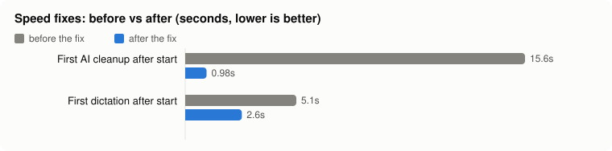
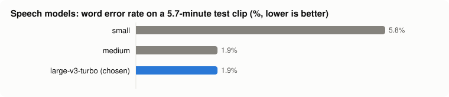
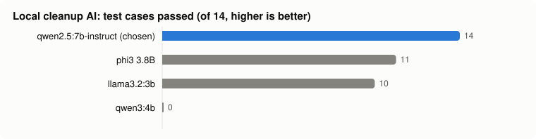
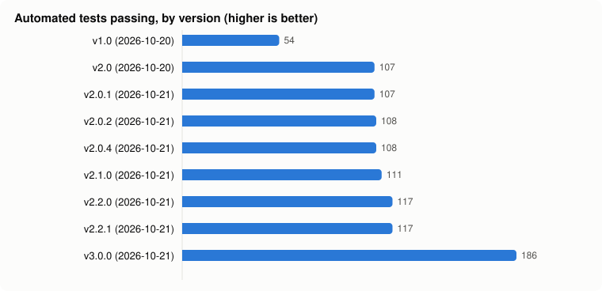

# VoiceType dashboard

Measured on one machine: Windows 11, RTX 4060 Laptop GPU (8 GB), Python 3.11. Every number comes from a script or document in this repo (source column). Regenerate with `scripts/make_dashboard.py` after editing `docs/metrics.json`.

## At a glance

|  | What it means | Source |
|---|---|---|
| **0** | network connections while dictating | `scripts/check_offline.py` |
| **0.5-1.6 s** | from releasing the key to text on screen | `docs/testing.md` |
| **1.9%** | word error rate, speech model (test audio) | `docs/benchmark.md` |
| **14 / 14** | cleanup cases passed by the local AI | `docs/cleanup-benchmark.md` |
| **6.6 / 8 GB** | GPU memory, speech + AI together | `docs/cleanup-benchmark.md` |

## How much faster it got

| Step | Before | After | Faster by | Version |
|---|---|---|---|---|
| First AI cleanup after start | 15.6 s | 0.98 s | 15.9x | v2.0 |
| First dictation after start | 5.1 s | 2.6 s | 2.0x | v2.0 |

## Which speech model, and why

| Model | Result | Also | Chosen |
|---|---|---|---|
| small | 5.8% | 8.3 s, ~0.4 GB GPU |  |
| medium | 1.9% | 17.9 s, ~1.1 GB GPU |  |
| large-v3-turbo | 1.9% | 8.4 s, ~1.2 GB GPU | yes |

## Which cleanup AI, and why

| Model | Result | Also | Chosen |
|---|---|---|---|
| qwen2.5:7b-instruct | 14 | 0.33 s median | yes |
| phi3 3.8B | 11 | 0.17 s median |  |
| llama3.2:3b | 10 | 0.24 s median |  |
| qwen3:4b | 0 | thinking-only build |  |

## Versions

| Version | Date | Tests | What changed |
|---|---|---|---|
| v1.0 | 2026-10-20 | 54 | Local dictation into any app: hotkeys, Whisper on the GPU, tray app, history |
| v2.0 | 2026-10-20 | 107 | Smart cleanup with a local AI, memory that learns from corrections, styles per app |
| v2.0.1 | 2026-10-21 | 107 | Published on GitHub, MIT license |
| v2.0.2 | 2026-10-21 | 108 | Everything stored inside the project folder |
| v2.0.4 | 2026-10-21 | 108 | History readable in Notepad, with original wording |
| v2.1.0 | 2026-10-21 | 111 | Voice recorder for fine-tuning |
| v2.2.0 | 2026-10-21 | 117 | Moving logo while recording; fine-tuning pipeline; dashboard |
| v2.2.1 | 2026-10-21 | 117 | Fine-tuning pipeline verified end to end (train, convert, compare) |

Full details: [VERSION_HISTORY.md](../VERSION_HISTORY.md).

## Fine-tuning on your own voice

| Test set | Clips | Base | Fine-tuned |
|---|---|---|---|
| held-out test clip (synthetic voice) | 1 | 0.0% | 0.0% |
| reference English | 1 | 0.0% | 0.0% |

**Pipeline test only, not your voice yet.** On 2026-10-21 the full fine-tuning pipeline (train, then merge, then convert, then compare) ran end to end on 12 synthetic test clips: 8 training steps in 1.0 min, peak GPU memory 2.1 GB, 13.1 M trainable parameters (1.6% of the model, LoRA rank 32). The trained model loaded in VoiceType's real engine with the same speed as the base model (0.28 s vs 0.27 s per clip) and no loss of accuracy on reference English. Both scored 0% errors because the test clips were synthetic speech labelled by the base model itself, so there was nothing to improve; the verdict was correctly NOT BETTER. The real comparison needs 30-60 minutes of your own recordings (`scripts/record_voice.py`).
